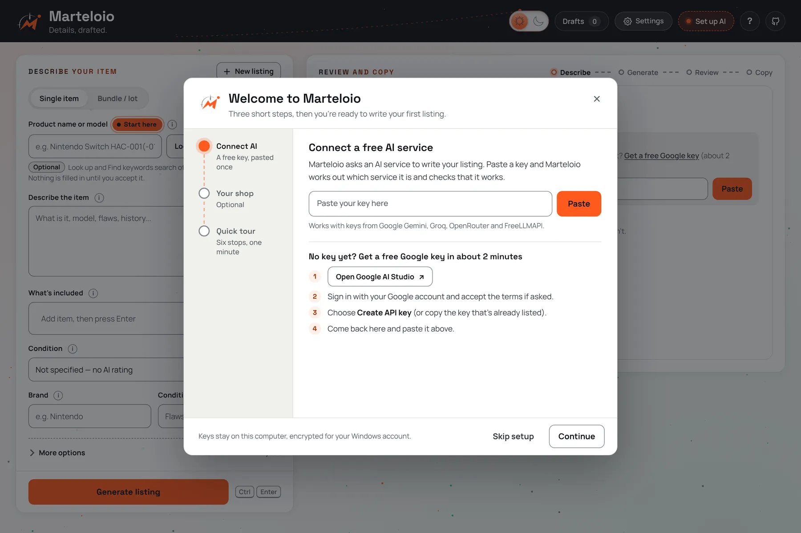

<h1 align="center">
  <picture>
    <source media="(prefers-color-scheme: dark)" srcset="docs/assets/readme-header-dark.png">
    
  </picture>
</h1>

**Details, drafted.** Marteloio turns the notes you jot about an item into an eBay
title and description you can paste straight in. It runs on your own computer,
works with free AI keys, and leaves every fact for you to check.

<p align="center">
  <a href="https://github.com/browser-b0X/marteloio/releases/latest/download/Marteloio-Setup.exe"></a>
</p>
<p align="center">
  Free · Windows 10 and 11 · about 12 MB · Mac or Linux? <a href="#mac-linux-or-running-from-source">Run from source</a>
</p>

Optional check: in PowerShell, `Get-FileHash .\Marteloio-Setup.exe -Algorithm SHA256` should show the same
SHA-256 as [Marteloio-Setup.exe.sha256](https://github.com/browser-b0X/marteloio/releases/latest/download/Marteloio-Setup.exe.sha256).

[Website](https://browser-b0x.github.io/marteloio/) ·
[User guide](docs/GUIDE.md) ·
[What's new](CHANGELOG.md) ·
[Report a bug or suggest an idea](https://github.com/browser-b0X/marteloio/issues)


<sub>Screenshots show made-up items, not real seller data.</sub>

## What happens next

1. **Your browser may warn you** that Marteloio-Setup.exe isn't commonly downloaded. Keep it:
   in Edge choose **…** › **Keep** › **Show more** › **Keep anyway**.
2. **Windows may show "Windows protected your PC"** when you open it, because the installer
   isn't code-signed yet. Choose **More info**, then **Run anyway**.

Setup has one page: choose whether you want a desktop shortcut, then **Install**. It needs no
administrator rights. When it finishes, Marteloio opens in your browser with a short **welcome
setup**: paste a free AI key and Marteloio recognises the service and tests it (a free Google
Gemini key takes about 2 minutes to get), add your shop details if you like, then take the
one-minute tour. Next time, open Marteloio from the Start menu or the desktop.

<picture>
  <source media="(prefers-color-scheme: dark)" srcset="docs/screenshots/welcome-dark.webp">
  
</picture>

## Features

- **Notes in, listing out.** Describe the item the way you would say it out loud:
  model, what's included, what you tested, every flaw. One request drafts the
  title, description, item specifics and highlights.
- **Set up without help.** A one-click Windows installer with its own Python, a welcome
  setup that connects a free AI key, a one-minute tour of the real screen, a Get set up
  guide that ticks itself off, and a tip beside every field.
- **eBay-ready HTML.** Every layout is self-contained: no scripts, no outside
  links, no web fonts, and a plain-text mobile summary at the top. Preview at
  desktop and phone width, shuffle the look, then copy the HTML or download it.
- **Honest about condition.** You choose the condition. Untested stays untested,
  For parts is never upgraded, every flaw you mention stays in, and an empty
  condition stays empty. Your own edits always win over anything filled in.
- **Bundles that fill themselves in.** Describe a lot once; each line or bullet becomes
  an item card and a What's included chip, without an AI request. Filled cards fold
  to a single line, and the brands of the items are collected for you.
- **Real specifications, only when you accept them.** Look up other sellers' eBay
  listings by name or barcode, review the specifications they list, and accept one
  as a clearly labelled reference. Find keywords shows the words other sellers use
  in their titles. Both are optional and need free eBay developer keys.
- **Fewer AI requests.** Save a listing as a template and start similar items from
  it with no request at all. Regenerate rewrites just the title, description or
  highlights with a short request.
- **Free AI with automatic fallback.** Paste a key for Google Gemini, Groq or OpenRouter
  (each has a free tier), or use FreeLLMAPI running on your PC; Marteloio finds it.
  If one service is busy, the next one answers.
- **Messages in plain words.** Each message says what happened and what to do next, then
  fades on its own. A step that failed keeps a short note until it's fixed.
- **Drafts you can come back to.** Autosave, the last ten drafts, draft backups,
  an 80-character title ruler, and light and dark themes.


## Installation

### Windows

Download [Marteloio-Setup.exe](https://github.com/browser-b0X/marteloio/releases/latest/download/Marteloio-Setup.exe)
and open it (see [What happens next](#what-happens-next) for the two warnings). Setup:

- installs Marteloio for your Windows account only, without administrator rights, in
  `%LOCALAPPDATA%\Programs\Marteloio`;
- brings its own Python, so there is nothing else to install;
- adds **Marteloio** and **Stop Marteloio** to the Start menu, and a desktop shortcut unless
  you untick it;
- opens Marteloio in your browser at `http://localhost:8080` when it finishes.

To stop Marteloio, use Start menu › **Stop Marteloio** or Settings › About › **Quit Marteloio**.
Get Marteloio only from this repository or its website; see
[Official sources](SECURITY.md#official-sources). Already using the ZIP version? See
[Moving from the ZIP version](docs/GUIDE.md#moving-from-the-zip-version).

### Mac, Linux or running from source

You need **Python 3.10 or newer**. There are no packages to install and no build step.

1. [Download the ZIP](https://github.com/browser-b0X/marteloio/archive/refs/heads/main.zip)
   and unzip it anywhere, or `git clone https://github.com/browser-b0X/marteloio.git`.
2. **macOS/Linux:** run `bash start-all.sh` (included, but not yet verified on those systems).
   **Windows:** double-click `start-all.bat`.
3. Your browser opens at `http://localhost:8080` with the welcome setup. If it doesn't, check
   `relay.log` in the Marteloio folder.
4. Optional on Windows: double-click `create-shortcuts.bat` once. It adds **Marteloio** and
   **Stop Marteloio** to the Start menu and a Marteloio shortcut to the desktop. Run it
   again if you move the folder.

To stop a source copy, use Settings › About › **Quit Marteloio**, or on Windows **Stop
Marteloio** or `stop.bat`; `relaunch.bat` stops and starts it again. Both check that the
running app belongs to this folder before stopping anything. To use a different port, copy
`.env.example` to `.env` and set `PORT`.

Marteloio is a single-user app that only listens on your own computer. Do not expose
it to the internet or a shared network.

## AI services

Marteloio needs at least one AI service. Each offers a free tier with limits it sets;
quotas, billing and availability depend on your account with that service.

| Service | What you need |
| --- | --- |
| Google Gemini | A free key from [Google AI Studio](https://aistudio.google.com/app/apikey). The easiest one: about 2 minutes with a Google account. |
| Groq | A free key from the [Groq console](https://console.groq.com/keys) |
| OpenRouter | A key from [OpenRouter](https://openrouter.ai/keys). Marteloio only uses its free models. |
| FreeLLMAPI | [FreeLLMAPI](https://github.com/tashfeenahmed/freellmapi) running on your PC or home network, and its key. It spreads requests over many free AI services. |

Paste any of these keys into the welcome setup or Settings › AI. Marteloio recognises which
service it belongs to, saves it and tests it. When FreeLLMAPI is running on your PC,
Marteloio finds it and tells you how to copy its key.

Services are tried in the order FreeLLMAPI, Google Gemini, Groq, OpenRouter. A busy service
is skipped until it is ready again, and a key that was turned down stays off until you
replace it. Each service has a **Use** switch to skip it without removing its key. The AI
button in the header says **Set up AI** until a service is connected, then **AI ready**.

## Optional eBay connection

**Look up** and **Find keywords** search other sellers' eBay listings through eBay's
Browse API. They need application keys from a free
[eBay Developers](https://developer.ebay.com/) account, entered in Settings › eBay.
Connecting your eBay account there also fills in your feedback numbers; you can type them in
Settings › Your shop instead. Everything else works without eBay keys.

References are other sellers' listing data, not manufacturer specifications. They
reach the AI as a separately labelled block and never change your condition, flaws,
accessories or policies.

## Writing a listing

1. **Describe** the item and choose its condition. For a lot, switch to **Bundle / lot**.
2. **Generate** the listing (or press Ctrl+Enter).
3. **Review** the title and the preview. Use **Edit content** to correct any section as
   plain text, or **Regenerate…** to redo one part.
4. **Copy HTML**, switch eBay's description box to HTML (the **< >** button) and paste.
   Check eBay's preview on desktop and phone before you publish.

Help (**?**) at the top of the page runs the tour again. Marteloio never publishes anything.
Generated listings end with a short "Listing created with Marteloio" line that follows eBay's
rules for third-party credits (ten words or fewer, no links, no web address); it is plain HTML
you can remove.

The [user guide](docs/GUIDE.md) covers the first run, connecting AI, bundles, references,
templates, editing, drafts and backups, and troubleshooting in detail.

## Where your data lives

There is no Marteloio account or server.

| What | Installed with Marteloio-Setup.exe | ZIP or source copy |
| --- | --- | --- |
| AI and eBay keys | `%LOCALAPPDATA%\Marteloio\.marteloio-secrets.enc` | `.marteloio-secrets.enc` in the Marteloio folder (Windows), or `.env` in plain text (macOS, Linux) |
| Settings and log | `settings.json` and `relay.log` in `%LOCALAPPDATA%\Marteloio` | The same files in the Marteloio folder |
| Drafts, Recent drafts, templates, shop details | Your browser, for `http://localhost:8080` | The same |

- **Keys** saved on Windows are encrypted with Windows DPAPI for your Windows account.
  Other programs running as your account can still decrypt them; this is not a password
  vault. Keys are never stored in the browser. Settings › About shows your data folder.
- **Drafts** belong to the browser and the address you open: clearing browser data removes
  them, so use **Back up draft** for anything important.
- **`relay.log`** is a local diagnostic file. Keys are redacted from AI service errors,
  but check and redact the log before sharing it.

## Network activity

Marteloio is local-first, not offline:

- **Generate** and **Regenerate** send the item details you entered (notes, brand,
  condition, included items, bundle items), keyword suggestions and any accepted
  reference to the AI service whose key you added; Regenerate also sends the current
  title. Seller details and statistics are not sent. If that service is unavailable,
  the same request may go to the next one. With FreeLLMAPI, the request goes to
  FreeLLMAPI on your PC or home network, which passes it to the services you set up there.
- **Testing a key** sends one tiny request to that service.
- **Look up** and **Find keywords** send the product name or barcode to eBay.
- **Connect eBay** and your feedback numbers contact eBay only when you use them.
- Looking for FreeLLMAPI (in the welcome setup and Settings › AI) only checks this computer.
- The app loads no remote fonts, scripts or analytics. Images you add to a listing
  by web address (such as a store logo) are fetched by your browser.

## Updating and uninstalling

**Update:** download the newer Marteloio-Setup.exe and run it. It closes Marteloio first,
replaces the program and keeps your keys, settings and drafts. For a ZIP or source copy,
replace the files (or `git pull`) and keep `.env` and `.marteloio-secrets.enc`.

**Uninstall:** in Windows Settings › Apps, choose Marteloio › **Uninstall**. It stops Marteloio
and asks "Also remove your saved keys and settings?"; **No** (the default) keeps them for a
later install. Drafts stay in your browser; clear its site data for `localhost:8080` to remove
them. For a ZIP or source copy: stop the app, run `create-shortcuts.bat /remove` if you added
shortcuts, and delete the folder.

## Troubleshooting

| Symptom | What to do |
| --- | --- |
| "Windows protected your PC" | The installer isn't code-signed yet. Choose **More info**, then **Run anyway**. |
| The browser doesn't open | Open `http://localhost:8080` yourself. If Marteloio says it is taking longer than usual, wait a minute and open it again; `relay.log` in the data folder says why. |
| "Another copy of Marteloio is already running from a different folder" | Stop the other copy (often the ZIP version: `stop.bat` in its folder), then open Marteloio again. |
| Another program is using port 8080 | Close that program, then open Marteloio again. Marteloio never stops software it didn't start. |
| "Marteloio couldn't read your saved keys" | This happens after moving to another PC or Windows account. Paste your keys again in Settings › AI (and Settings › eBay). |
| The AI services are busy | Wait as the message says, or add a second service. Your draft is kept. |
| FreeLLMAPI isn't found or has no AI services yet | Start FreeLLMAPI and add a key on its Keys page, then choose **Find it again** or **Test again** in Settings › AI. |

More in the [user guide](docs/GUIDE.md#troubleshooting).

## Development

| File | Purpose |
| --- | --- |
| `index.html` | The interface, state, requests and listing templates |
| `listing-core.js` | Shared normalization, condition, keyword, bundle, message and first-run helpers |
| `server.py` | Local relay: AI and eBay requests, settings and encrypted key storage |
| `ai_providers.py` | AI service order, fallback, rate-limit handling, FreeLLMAPI and model retirement |
| `app_paths.py` | Where the code and data live, the version and the build id |
| `launch.py` | Starts or reuses the app and opens the browser (`--stop`, `--version`) |
| `stop-services.ps1` | Windows ownership checks for `stop.bat` and `relaunch.bat` |
| `create-shortcuts.ps1` | Start menu and desktop shortcuts for a ZIP or source copy |
| `packaging/` | The Windows installer; see [BUILDING.md](BUILDING.md) |
| `docs/` | The project website, the user guide and screenshots |
| `tests/` | Offline Python, Node and browser checks |

Run the checks:

```sh
python -B -m unittest discover -s tests -p "test_*.py"
node tests/test_listing_core.js
python -B tests/serve_frontend_checks.py   # then open the printed address
```

On Windows, also run `tests/test_stop_services.ps1` and `tests/test_create_shortcuts.ps1`
with `powershell -NoProfile -ExecutionPolicy Bypass -File`.
All checks use synthetic data and mocked services; they do not contact AI services
or eBay. The same offline checks run in GitHub Actions on Windows and Linux.
[BUILDING.md](BUILDING.md) explains how to build and publish the Windows installer, and
[CHANGELOG.md](CHANGELOG.md) lists what changed in each version.

## Security

See [SECURITY.md](SECURITY.md) before sharing logs, screenshots or bug reports.

## Feedback & Suggestions

Help make **browser-b0X** better.

- 🐛 **Found a bug?** Submit a structured [Bug Report](https://github.com/browser-b0X/marteloio/issues/new/choose).
  Help (**?**) › **Report a problem** in the app opens the same page.
- 💡 **Have an idea or question?** Start a discussion in [GitHub Discussions](https://github.com/browser-b0X/marteloio/discussions)
- 🤝 **Want to contribute?** Pull requests and improvements are always welcome.

## Support the project

<p align="center">
  <a href="https://ko-fi.com/browserb0x">
    
  </a>
  &nbsp;
  <a href="https://buymeacoffee.com/browserbox">
    
  </a>
</p>

> Every contribution is appreciated, but never expected.<br>
> Using the project, reporting bugs, and sharing it with others helps too.

## License

The source code is [MIT](LICENSE), copyright 2026 browser-b0X.

The **Marteloio name and logo are not covered by the MIT License**; they are reserved
so that people can tell the official app from modified copies. Forks are welcome under a
different name and logo. See [TRADEMARKS.md](TRADEMARKS.md). The only official sources are
this repository and [its website](https://browser-b0x.github.io/marteloio/).

The bundled Manrope and Space Grotesk fonts are under the SIL Open Font License
([Manrope](assets/fonts/OFL-Manrope.txt), [Space Grotesk](assets/fonts/OFL-SpaceGrotesk.txt)).
eBay is a trademark of eBay Inc.; Marteloio is an independent project and is not
affiliated with or endorsed by eBay.
