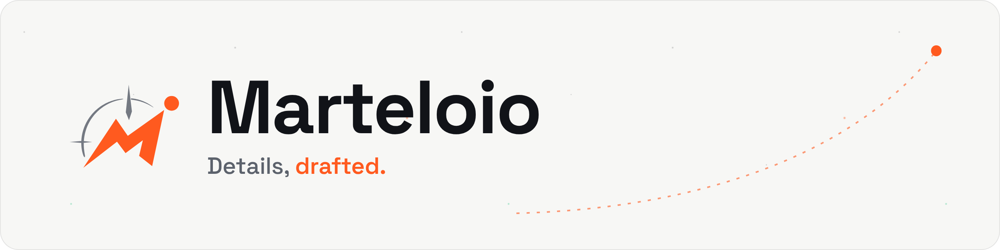
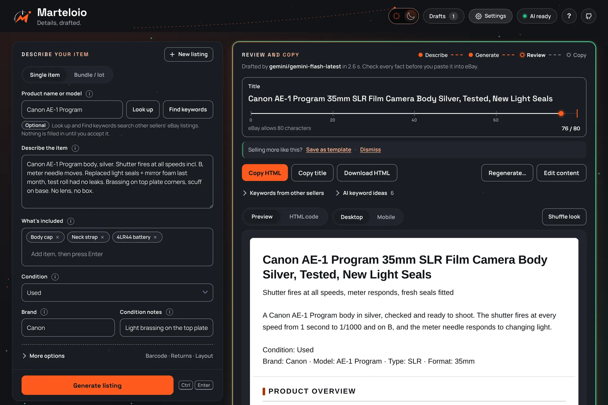
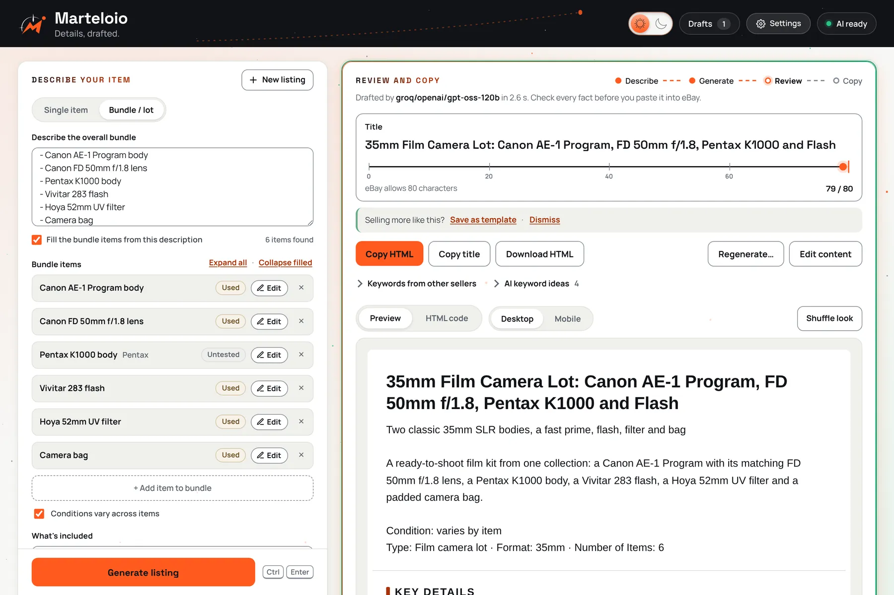

<h1 align="center">
  <picture>
    <source media="(prefers-color-scheme: dark)" srcset="docs/assets/readme-header-dark.png">
    
  </picture>
</h1>

**Details, drafted.** Marteloio turns the notes you jot about an item into an eBay
title and description you can paste straight in. It runs on your own computer,
works with free AI keys, and leaves every fact for you to check.

[Website](https://browser-b0x.github.io/marteloio/) ·
[Install](#installation) ·
[Report a bug or suggest an idea](https://github.com/browser-b0X/marteloio/issues)





<sub>Screenshots show sample items, not real seller data.</sub>

## Features

- **Notes in, listing out.** Describe the item the way you would say it out loud:
  model, what's included, what you tested, every flaw. One request drafts the
  title, description, item specifics and highlights.
- **eBay-ready HTML.** Every layout is self-contained: no scripts, no outside
  links, no web fonts, and a plain-text mobile summary at the top. Preview at
  desktop and phone width, shuffle the look, then copy the HTML or download it.
- **Honest about condition.** You choose the condition. Untested stays untested,
  For parts is never upgraded, every flaw you mention stays in, and an empty
  condition stays empty. Your own edits always win over anything filled in.
- **Bundles that fill themselves in.** Describe a lot once; each line becomes an
  item card and a What's included chip, without an AI request. Filled cards fold
  to a single line, and the brands of the items are collected for you.
- **Real specifications, only when you accept them.** Look up other sellers' eBay
  listings by name or barcode, review the specifications they list, and accept one
  as a clearly labelled reference. Find keywords shows the words other sellers use
  in their titles.
- **Fewer AI requests.** Save a listing as a template and start similar items from
  it with no request at all. Regenerate rewrites just the title, description or
  highlights with a short request.
- **Free keys with automatic fallback.** Add a key for Google Gemini, Groq or
  OpenRouter (each has a free tier). If one is rate-limited, the next one answers.
- **Drafts you can come back to.** Autosave, the last ten drafts, draft backups,
  an 80-character title ruler, and light and dark themes.

## Installation

You need **Python 3.10 or newer**. There are no packages to install and no build step.

1. [Download the ZIP](https://github.com/browser-b0X/marteloio/archive/refs/heads/main.zip)
   and unzip it anywhere, or `git clone https://github.com/browser-b0X/marteloio.git`.
   Get it only from this repository; see [Official sources](SECURITY.md#official-sources).
2. **Windows:** double-click `start-all.bat`. **macOS/Linux:** run `bash start-all.sh`
   (included, but not yet verified on those systems).
3. Your browser opens at `http://127.0.0.1:8080`. If it doesn't, check `relay.log`
   in the project folder.
4. Open **Settings**, paste a key for at least one AI provider and save.
5. Optional: double-click `create-shortcuts.bat` once. It adds **Marteloio** and
   **Stop Marteloio** to the Start menu and a Marteloio shortcut to the desktop, all with
   the Marteloio icon, so you don't have to open the folder again. Right-click the Start
   menu entry to pin it to the taskbar. Run it again if you move the folder.

To stop the app on Windows, use **Stop Marteloio** or run `stop.bat`; `relaunch.bat`
stops and starts it again.
Both check that the running app is this project before stopping anything. To use a
different port, copy `.env.example` to `.env` and set `PORT`.

Marteloio is a single-user app that only listens on your own computer. Do not expose
it to the internet or a shared network.

## AI providers

Marteloio needs a key from at least one provider. Each offers a free tier with limits
it sets; quotas, billing and availability depend on your account with that provider.

| Provider | Where to get a key |
| --- | --- |
| Google Gemini | [Google AI Studio](https://aistudio.google.com/apikey) |
| Groq | [Groq console](https://console.groq.com/keys) |
| OpenRouter | [OpenRouter keys](https://openrouter.ai/keys) (free models by default) |

Providers with a key are tried in that order. A rate-limited provider is skipped until
it is ready again and a rejected key stays off until you replace it. The status pill in
the header shows whether generation is ready. Keys saved in Settings apply to the next
request; no restart is needed.

## Optional eBay connection

**Look up** and **Find keywords** search other sellers' eBay listings through eBay's
Browse API. They need application keys from a free
[eBay Developers](https://developer.ebay.com/) account, entered in **Settings**.
Seller statistics in the listing header also need you to connect your eBay account.
Everything else works without eBay keys.

References are other sellers' listing data, not manufacturer specifications. They
reach the AI as a separately labelled block and never change your condition, flaws,
accessories or policies.

## Writing a listing

1. **Describe** the item and choose its condition. For a lot, switch to **Bundle / lot**.
2. **Generate** the listing (or press Ctrl+Enter).
3. **Review** the title and the preview. Use **Edit content** to correct any section as
   plain text, or **Regenerate…** to redo one part.
4. **Copy HTML** and paste it into the HTML view of eBay's description editor. Check
   eBay's preview on desktop and phone before you publish.

Marteloio never publishes anything. Generated listings end with a short "Listing
created with Marteloio" line that follows eBay's rules for third-party credits (ten
words or fewer, no links, no web address); it is plain HTML you can remove.

The [user guide](docs/GUIDE.md) covers bundles, references, templates, editing,
drafts and backups, and troubleshooting in detail.

## Local data and privacy

There is no Marteloio account or server.

- **Drafts, history and templates** are saved in your browser's local storage for the
  address you open the app at. Clearing browser data removes them; use **Back up draft**
  for anything important.
- **Keys** saved in Settings are encrypted with Windows DPAPI for your Windows account
  in `.marteloio-secrets.enc` in the project folder. Other programs running as your
  account can still decrypt them; this is not a password vault. Without DPAPI (macOS,
  Linux) keys are kept in plain text in `.env`. Keys are never stored in the browser.
- **`relay.log`** is a local diagnostic file. Keys are redacted from provider errors,
  but check and redact the log before sharing it.

## Network activity

Marteloio is local-first, not offline:

- **Generate** and **Regenerate** send the item details you entered (notes, brand,
  condition, included items, bundle items), keyword suggestions and any accepted
  reference to the AI provider whose key you added; Regenerate also sends the current
  title. Seller details and statistics are not sent. If that provider is unavailable,
  the same request may go to the next provider.
- **Look up** and **Find keywords** send the product name or barcode to eBay.
- **Connect eBay** and seller statistics contact eBay only when you use them.
- The app loads no remote fonts, scripts or analytics. Images you add to a listing
  by URL (such as a store logo) are fetched by your browser.

## Troubleshooting

| Symptom | What to do |
| --- | --- |
| The browser doesn't open | Check `relay.log`, your Python version and whether port 8080 is taken. |
| AI status shows offline | Add or check a provider key in Settings. |
| Generation reports 429 or 503 | The provider is rate-limited or down. Wait as suggested, or add another provider's key. Your draft is kept. |
| A key is rejected | Paste a fresh key in Settings and save. |
| Port already in use | Stop the other program or set another `PORT` in `.env`. Marteloio never stops software it didn't start. |

More in the [user guide](docs/GUIDE.md#troubleshooting).

## Uninstall

Stop the app (`stop.bat` on Windows), run `create-shortcuts.bat /remove` if you added
shortcuts, and delete the project folder. That removes the
app, `.env`, the encrypted key store and logs. Drafts live in your browser; clear site
data for `127.0.0.1:8080` to remove them.

## Development

| File | Purpose |
| --- | --- |
| `index.html` | The interface, state, requests and listing templates |
| `listing-core.js` | Shared normalization, condition, keyword and bundle parsing helpers |
| `server.py` | Local relay: AI and eBay requests, settings and encrypted key storage |
| `ai_providers.py` | Provider order, fallback, rate-limit handling and model retirement |
| `launch.py` | Launch configuration and readiness checks |
| `stop-services.ps1` | Windows ownership checks for stopping the app |
| `create-shortcuts.ps1` | Start menu and desktop shortcuts for the current Windows user |
| `docs/` | The project website and screenshots |
| `tests/` | Offline Python, Node and browser checks |

Run the checks:

```sh
python -B -m unittest discover -s tests -p "test_*.py"
node tests/test_listing_core.js
python -B tests/serve_frontend_checks.py   # then open the printed address
```

On Windows, also run `tests/test_stop_services.ps1` and `tests/test_create_shortcuts.ps1`
with `powershell -NoProfile -ExecutionPolicy Bypass -File`.
All checks use synthetic data and mocked services; they do not contact AI providers
or eBay. The same offline checks run in GitHub Actions on Windows and Linux.

## Security

See [SECURITY.md](SECURITY.md) before sharing logs, screenshots or bug reports.

## Feedback & Suggestions

Help make **browser-b0X** better.

- 🐛 **Found a bug?** Submit a structured [Bug Report](https://github.com/browser-b0X/marteloio/issues/new/choose).
  The GitHub button at the right of the app's header opens the same page.
- 💡 **Have an idea or question?** Start a discussion in [GitHub Discussions](https://github.com/browser-b0X/marteloio/discussions)
- 🤝 **Want to contribute?** Pull requests and improvements are always welcome.

## Support the project

<p align="center">
  <a href="https://ko-fi.com/browserb0x">
    
  </a>
  &nbsp;
  <a href="https://buymeacoffee.com/browserbox">
    
  </a>
</p>

> Every contribution is appreciated, but never expected.<br>
> Using the project, reporting bugs, and sharing it with others helps too.

## License

The source code is [MIT](LICENSE), copyright 2026 browser-b0X.

The **Marteloio name and logo are not covered by the MIT License**; they are reserved
so that people can tell the official app from modified copies. Forks are welcome under a
different name and logo. See [TRADEMARKS.md](TRADEMARKS.md). The only official sources are
this repository and [its website](https://browser-b0x.github.io/marteloio/).

The bundled Manrope and Space Grotesk fonts are under the SIL Open Font License
([Manrope](assets/fonts/OFL-Manrope.txt), [Space Grotesk](assets/fonts/OFL-SpaceGrotesk.txt)).
eBay is a trademark of eBay Inc.; Marteloio is an independent project and is not
affiliated with or endorsed by eBay.
